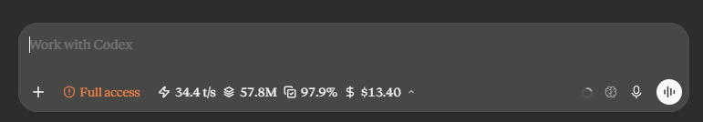
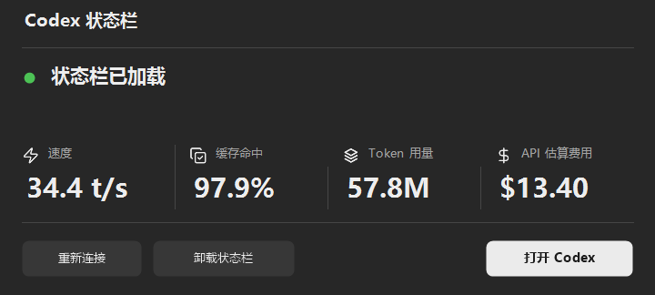

<div align="center">


# Codex Token Statusbar

**把速度、缓存、用量和费用，放回对话里。**

轻量的 Windows Codex 内嵌状态栏，沿用客户端的字体、主题和交互。

[](https://github.com/FlowingCloud16/CodexTokenStatusbar/releases/tag/v0.6.2)


[](LICENSE)

[**下载 EXE**](https://github.com/FlowingCloud16/CodexTokenStatusbar/releases/latest) · [快速开始](#快速开始) · [功能](#功能) · [开发](#开发) · [反馈问题](https://github.com/FlowingCloud16/CodexTokenStatusbar/issues)

<br />



</div>

## 一眼看到当前对话

| 速度 | 缓存命中 | Token 用量 | API 估算费用 |
| :--- | :--- | :--- | :--- |
| 以 `t/s` 显示模型输出阶段速度 | 查看输入中被缓存复用的比例 | 汇总当前对话的输入与输出 | 按模型与内置 API 单价折算 |

点击状态栏即可展开详情，查看最近一轮的输入、输出、缓存和计费明细。

## 快速开始

1. 从 [Releases](https://github.com/FlowingCloud16/CodexTokenStatusbar/releases/latest) 下载 `CodexTokenStatusbar-0.6.2.exe`。
2. 正常打开 Codex，再双击下载的 EXE。
3. 打开一个对话，状态栏会出现在输入框旁边。

**无需安装 Node.js，无需开启调试端口，无需为加载状态栏而重启 Codex。**

升级时，先在托盘菜单选择“退出加载器”，再打开新版本。直接关闭主窗口会收进托盘。

<details>
<summary>查看主窗口</summary>

<br />



主窗口截图使用示例数据。

| 操作 | 作用 |
| :--- | :--- |
| 重新连接 | 连接中断后重新加载 |
| 卸载状态栏 | 移除状态栏并停止后台，Codex 保持打开 |
| 打开 Codex | 打开或切到客户端窗口 |
| 托盘 → 退出加载器 | 卸载状态栏并退出本程序 |

</details>

## 功能

- **跟随当前对话**：切换对话时更新统计，展开查看最近一轮数据。
- **三种布局**：自适应、独立一行、单图标入口，在状态栏展开菜单中切换。
- **保留模型切换空间**：自适应布局优先显示速度和缓存，有空间再显示费用、用量。
- **跟随客户端外观**：沿用字体与深浅主题，使用轻柔的展开和切换动画，支持减少动态效果。
- **中文随客户端切换**：Codex 使用中文时显示中文，其他语言显示英文。
- **本机统计**：读取本机用量记录，不需要 API Key，不上传对话内容。
- **单文件分发**：当前 EXE 约 208.5 KiB，使用 Windows 自带运行库。

| 布局 | 适合场景 |
| :--- | :--- |
| 模型优先自适应 | 日常使用，优先保留模型选择入口 |
| 统计独立一行 | 希望四项统计完整展示 |
| 单图标入口 | 输入框空间有限，按需展开查看 |

## 统计怎么算

### 速度与用量

速度参照 [dongyue-19/codex-statusbar](https://github.com/dongyue-19/codex-statusbar) 的计算方法：**本轮官方输出 Token ÷ 推理与回复的合并输出时间**。只记录 `Reasoning`、`AgentMessage` 的输出窗口，重叠时间计算一次，工具执行不单独加入分母。

采样结果采用 **0.35 指数平滑**，每轮重新计算。工具运行或等待新采样时保留上次速度，完成后固定该轮结果，不再切回整轮吞吐。

这是基于官方计数和输出窗口的估算，包含推理输出，不是逐 Token 流的瞬时测速。缺少本轮开始记录、官方输出计数或有效输出窗口时显示等待，不用整轮耗时补算。算法来源与许可见 [第三方说明](THIRD_PARTY_NOTICES.md)。

```text
对话用量 = 累计输入 Token + 累计输出 Token
缓存命中率 = 缓存输入 Token ÷ 输入 Token × 100%
```

缓存输入已包含在输入中，推理输出已包含在输出中，汇总时不重复相加。

### 费用

按每个响应的模型、计费档位、上下文长度和缓存类型分别计算，再汇总到当前对话。状态栏中的金额保留两位小数，详情展示更高精度。

```text
估算费用 = 普通输入费用 + 缓存读取费用 + 缓存写入费用 + 输出费用
```

内置价格表的核对日期为 **2026-11-09**，价格随程序版本提供，不自动联网更新。完整条目见 [api-prices.json](src/api-prices.json)。

遇到未知模型、计费档位或缺失的历史记录，会显示已计价小计，并在详情标出缺口。

> 费用是按 API 单价折算的估算值，不代表 Codex 订阅扣款或实际账单。

## 系统与兼容

| 项目 | 当前范围 |
| :--- | :--- |
| 操作系统 | Windows 11 x64 |
| 目标客户端 | 以 `OpenAI.Codex` 安装包分发的 Windows 客户端，部分版本的窗口名称为 ChatGPT |
| 运行依赖 | Windows 自带的 .NET Framework、SQLite 和 UCRT；无需另装 Node.js |
| 实测客户端 | `26.1103.7773.0` |
| 实测运行时 | V8 `15.7.112.23` |
| 程序签名 | 当前版本尚未签名 |

程序不会仅因客户端版本号陌生而拒绝加载；底层接口发生变化时，仍可能需要更新适配，无法保证所有未来版本都可用。

已验证正常运行中的客户端注入、卸载和重连。0.6.1 还修复了任务栏图标关联，并验证了系统注册入口激活；客户端完全退出后的完整启动流程尚未单独验收。

<details>
<summary>连接方式与本地文件</summary>

状态栏通过短暂的主线程 DLL Hook 接入客户端现有运行环境，完成后撤销 Hook、卸载 DLL。后续通过本机命名管道更新界面，统计和计费由加载器内的 C# 后台处理。

不修改 Codex 安装包、账号或官方快捷方式，不注册开机启动，不强制结束 Codex。

| 本地位置 | 内容 |
| :--- | :--- |
| `%LOCALAPPDATA%\CodexTokenStatusbar\versions\` | 从 EXE 解出的程序资源 |
| `%LOCALAPPDATA%\CodexTokenStatusbar\native-experiment\` | 布局设置、连接和运行状态 |
| `%LOCALAPPDATA%\CodexTokenStatusbar\launcher.log` | 错误日志 |

`bridge.json` 含本机连接令牌；反馈问题时不要上传该文件或完整的会话记录。

</details>

## 开发

开发环境需要 Node.js 24+、PowerShell 7、Windows .NET Framework C# 编译器，以及已加入 `PATH` 的 x64 MinGW-w64 GCC。**这些是开发工具，使用成品 EXE 不需要安装。**

```powershell
git clone https://github.com/FlowingCloud16/CodexTokenStatusbar.git
cd CodexTokenStatusbar
npm ci
npm run build
pwsh -NoProfile -File .\tools\build-desktop.ps1
```

输出文件为 `release/CodexTokenStatusbar-0.6.2.exe`。默认构建免 Node 版；已有有效 `dist/` 文件时，也可直接运行 `tools/build-portable.ps1`。

### 验证

```powershell
npm test
npm run test:dotnet
pwsh -NoProfile -File .\tools\test-portable.ps1
```

测试覆盖统计、速度采样、费用、重复通知、对话归属、日志截断与替换、SQLite WAL、窗口和管道。成品自检会清空子进程的 Node 搜索路径，验证运行时不依赖 Node；`test-portable.ps1` 不操作正在运行的 Codex。

### 目录

```text
desktop/     C# 主窗口、统计计费与连接后台
src/         内嵌界面、统计逻辑与 API 价格表
native/      原生接入组件与客户端桥接
tests/       JavaScript 单元测试
tools/       构建、验证与清理工具
dist/        已构建的内嵌页面组件
docs/        README 图片与发布说明
```

清理构建缓存和旧版本时，运行下面的命令预览；添加 `-Apply` 才会删除：

```powershell
pwsh -NoProfile -File .\tools\clean-project.ps1
```

### 发布

仓库保留当前已验收的成品 EXE。向 `main` 提交成品和发布说明，或推送 `v主版本.次版本.修订号` 标签时，GitHub Actions 会核对版本号和 SHA-256，再创建 Release 并上传该成品。已经发布的版本保持原样。

发布流程使用 GitHub 提供的临时令牌，无需另配个人访问令牌。发布说明保存在 `docs/releases/`；本地打包生成的 JSON 不上传。

## 常见问题

**为什么费用和我的订阅不一样？** 这里计算的是相应用量按 API 单价折算的金额。订阅配额和实际账单有各自的规则。

**为什么速度暂时是 `--`？** 当前还没有完整的模型输出计时和官方计数。新对话、压缩上下文或历史记录不完整时都可能出现；收到有效采样后会更新。

**客户端升级后连不上怎么办？** 先在主窗口点击“重新连接”。如果底层接口发生变化，请提交客户端版本、状态栏版本和错误信息。

**为什么 Windows 显示未知发布者？** 当前 EXE 尚未签名。发布页提供 SHA-256，便于核对下载文件。

**只下载 EXE 就能用吗？** 可以。源码目录和打包生成的同名 JSON 都不需要；首次运行时会自动解出所需资源。

## 许可与致谢

项目采用 [MIT 许可证](LICENSE)，作者为 [FlowingCloud16](https://github.com/FlowingCloud16)。

界面图标来自 [Lucide](https://lucide.dev/)，保留其 [ISC 许可证](desktop/licenses/lucide-0.468.0-LICENSE)。第三方许可说明见 [THIRD_PARTY_NOTICES.md](THIRD_PARTY_NOTICES.md)。

这是独立的社区项目，与 OpenAI 无隶属或背书关系。
